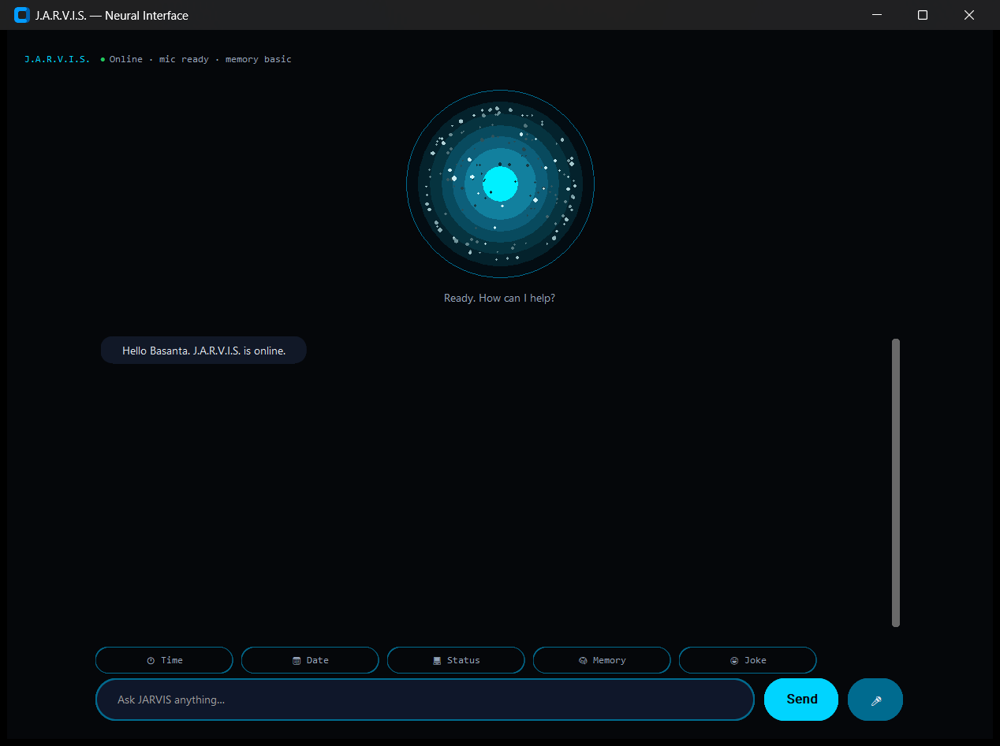

# J.A.R.V.I.S. — Personal AI Assistant

A Python desktop assistant that talks, listens, and remembers — built around a voice-first, single-screen interface. It answers through OpenAI-compatible providers (OpenAI, OpenRouter, Grok, Groq), falls back to offline responses when no provider is configured, and keeps its memory local to your machine.

[](https://github.com/basanta-codexa/AI-Jarvis/actions/workflows/tests.yml)

-lightgrey)



## What it can do

- **Converse** — one prompt does the routing: built-in skills (time, date, system status, app/website launcher, web search, memory) answer directly; everything else goes to an AI provider, with deterministic offline fallbacks when no key is set or a request fails.
- **Voice in** — microphone capture via `sounddevice` with room-noise calibration, voice-onset detection, and automatic re-listening after the assistant finishes speaking. Voice input is transcribed by Google Web Speech.
- **Voice out** — Windows text-to-speech through PowerShell System.Speech; speech is queued and never blocks the UI.
- **Remember** — conversation history in local JSON (atomic writes; a corrupt file is backed up, never silently erased). Optional semantic memory via ChromaDB for recall (`pip install -e ".[vector]"`). `forget everything` wipes both stores — verified, not just claimed.
- **Honest status** — the UI shows only real subsystem state (AI provider, microphone, memory); there are no invented dashboards.
- **CLI mode** — the same assistant in a plain terminal: `python main.py --cli`.

## Requirements

| Requirement | Notes |
|---|---|
| Python ≥ 3.10 | Tested on 3.10 and 3.14 (CI) |
| Platform | Windows recommended (native TTS). On Linux/macOS, TTS is disabled; GUI and everything else works |
| Microphone | Optional. On Linux, install `libportaudio2`; without a usable mic, voice input disables cleanly |
| Internet | For AI providers, Google Web Speech transcription (voice only), and the one-time embedding-model download if `.[vector]` is used |
| API key | Optional — the app is useful without one (skills + offline fallback) |

## Quick start

```powershell
py -3 -m venv .venv
.\.venv\Scripts\Activate.ps1
python -m pip install --upgrade pip
python -m pip install -e .
Copy-Item .env.example .env
```

Edit `.env` (at minimum `USER_NAME`; optionally an AI provider and key), then:

```powershell
python main.py          # desktop interface (default)
python main.py --cli    # terminal mode
```

Configuration example using Groq (free tier available):

```dotenv
AI_PROVIDER=groq
OPENAI_API_KEY=your_key_here
AI_MODEL=llama-3.1-8b-instant
```

Installation with the identical dependency set is also available as `pip install -r requirements.txt` (it delegates to `pyproject.toml`, the single source of truth).

## Configuration

All settings come from `.env` in the project root (see `.env.example`). Common keys:

| Variable | Description | Default |
|---|---|---|
| `USER_NAME` | Name used in greetings | `Sir` |
| `AI_PROVIDER` | `openai`, `openrouter`, `grok`, or `groq` | `openai` |
| `OPENAI_API_KEY` | Key for the selected provider (or empty for offline mode) | — |
| `AI_MODEL` | Model identifier accepted by the provider | `gpt-3.5-turbo` |
| `AI_TEMPERATURE` | Response creativity | `0.7` |
| `AI_MAX_TOKENS` | Max response tokens | `600` |
| `AI_REQUEST_TIMEOUT` | Request timeout in seconds | `30` |
| `AI_MAX_RETRIES` | Retries on transient provider errors | `1` |

`.env` is git-ignored and must stay that way; rotate any key that has ever been committed or shared.

## Architecture

```text
voice ──► sounddevice ──► Google Web Speech ──┐
                                               ├──► Orchestrator ──► Skills (first match wins)
keyboard/CLI ──────────────────────────────────┘          │
                                        no skill matched ▼
                                     AI provider (OpenAI-compatible) ──► offline fallback
                                               │
                                               ▼
            conversation.json (atomic) · optional ChromaDB · TTS (queued, non-blocking)
```

Key design rules:

- **Skills before AI** — deterministic commands never hit the network; the AI provider only sees what no skill handles.
- **Everything degrades gracefully** — no API key, no microphone, no ChromaDB, or no network: the app still works, with clear in-app status instead of fake indicators.
- **Memory is honest** — atomic JSON writes, corrupt files backed up (never silently dropped), and `forget everything` deletes both the history file and the vector collection.

## Project layout

```text
main.py                    Entry point (GUI default, --cli for terminal)
src/ai_jarvis/
  config/                  Settings (loaded from .env) and UI palette
  core/                    Orchestrator, plugin manager, memory system
  skills/                  Time/date/status, app launcher, web search, memory, system
  ui/                      CustomTkinter single-screen interface
  voice/                   sounddevice capture (STT), PowerShell TTS
tests/                     Unit tests (no display required)
.github/workflows/tests.yml  CI: Windows/Ubuntu × Python 3.10/3.14
```

## Development

```powershell
python -m pip install -e ".[dev]"   # pytest, black, mypy, ruff
python -m pip install -e ".[vector]" # optional: ChromaDB + sentence-transformers
python -m pytest
```

33 tests cover orchestration, skills, memory (including corrupt-file handling and vector-store reset), TTS/STT voice logic (mocked audio), and the status line. CI installs the real package and runs the suite on Windows and Ubuntu with Python 3.10 and 3.14. Voice/vector paths are tested against fakes — no microphone or embedding model is required.

## Data & privacy

- Conversation history lives in `data/conversation.json` and the optional vector DB in `data/chroma_db/` — both are excluded from git and never leave your machine. Delete the `data/` directory to erase everything.
- Voice phrases are sent to Google Web Speech for transcription. If that is unacceptable, use the text input or `--cli`; nothing else is transmitted except your AI provider requests.
- No telemetry, no analytics, no background network calls beyond the above.

## Limitations

- Native TTS is Windows-only (PowerShell System.Speech); other platforms get silent text responses.
- No wake word — after JARVIS speaks, the microphone arms itself for 5 seconds and disarms on silence; click the reactor or the mic button to override.
- Commands are limited to a whitelist of apps/websites (by design; no arbitrary shell access).
- Semantic memory downloads an embedding model on first use and pulls in PyTorch-sized dependencies — that's why it's an optional extra.

## Author

Basanta Kumar Mohanty ([@basanta-codexa](https://github.com/basanta-codexa)) — personal project, actively iterated.
